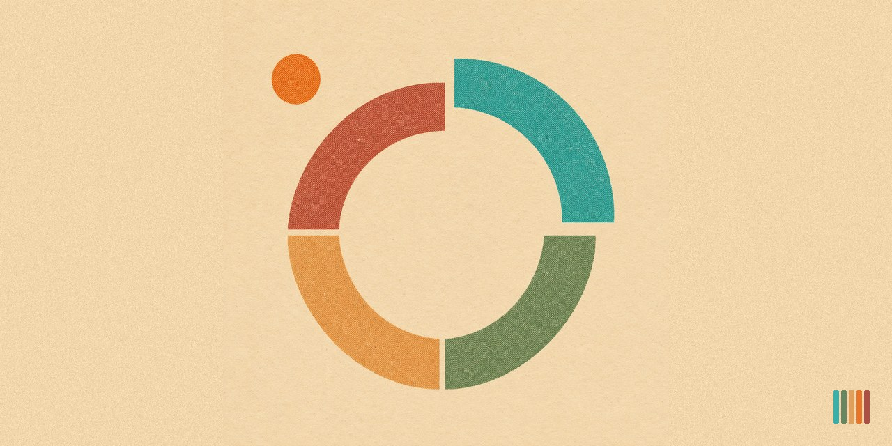

# pvc-end-set

<p align="center"></p>

  

> Closes a work set in one command: lab notes, memory notes, a local commit and the line for /compact.

A Claude Code skill for the end of a block of work. Made by Pro Vibe Coding. One phrase, "end set", runs the four steps that keep a project easy to pick up again: the lessons of the session go into `CLAUDE.md`, the memory notes of the project get current, the work gets a local commit, and you get a ready line to paste for `/compact`. It grew out of daily use, where those four requests came as one long sentence at the end of every session.

## Table of Contents

- [Key Features](#key-features)
- [Install](#install)
- [Usage](#usage)
- [How It Works](#how-it-works)
- [Output Rubric](#output-rubric)
- [Known Limitations](#known-limitations)
- [Changelog](#changelog)
- [License](#license)

## Key Features

- Four steps in a fixed order: `CLAUDE.md`, memory, commit, the `/compact` line.
- Lab notes follow the rules of `pvc-claude-md`: dated entries, the latest 10 in `CLAUDE.md`, older ones in `LABS.md`.
- Memory is the notes folder that Claude Code keeps per project. No server and no MCP tool has to run.
- The commit follows `pvc-git-commit-message-local`: the PVC format, local only, never a push.
- The `/compact` line names the version and the topic of the set. It stays under 80 characters, so a terminal does not wrap it.
- Safe to run twice: no duplicate notes, and a clean tree gets a refusal line in place of an empty commit.

## Install

This is a Claude Code skill. Pick the path that matches where you want it available.

**From the pvc-stack repo:** clone `https://github.com/pglbiscuite/pvc-stack`, then copy the folder `.claude/skills/pvc-end-set` to one of the places listed here. Keep the folder name `pvc-end-set`: a project or personal skill takes its command name from the directory name.

The skill needs two other skills from the same repo next to it: `pvc-claude-md` and `pvc-git-commit-message-local`. Copy all three.

### Project-local (one repo)

Drop the folders into the repo's `.claude/skills/`:

```text
your-project/
└── .claude/
    └── skills/
        ├── pvc-end-set/
        │   ├── SKILL.md
        │   ├── README.md
        │   └── REQUIREMENTS.md
        ├── pvc-claude-md/
        └── pvc-git-commit-message-local/
```

### Personal (all your projects)

Copy the folders to your user-level skills directory:

```text
Windows:        %USERPROFILE%\.claude\skills\pvc-end-set\
macOS / Linux:  ~/.claude/skills/pvc-end-set/
```

### Polyrepo / monorepo

Place it once at `.claude/skills/pvc-end-set/` in the directory you open Claude Code from. The skill is available whenever you launch Claude Code from that root.

### As part of a plugin

If you bundle skills as a Claude Code plugin, include `pvc-end-set/` and its two helper skills in the plugin's `skills/` directory. Claude Code finds the skills in that folder when the plugin loads.

### Verify the install

Start a new Claude Code session, then ask:

```text
What skills are available?
```

Confirm `pvc-end-set` appears in the list. The skill needs git and the two helper skills, see [REQUIREMENTS.md](REQUIREMENTS.md).

## Usage

Say it in plain language at the end of a block of work. Any of these phrasings trigger the skill:

```text
end set
close the set
wrap up the session
save and commit
```

Agent response. One block per step, then the line to paste:

```text
CLAUDE.md: 2 lab notes added, 2 rotated to LABS.md, 1 pointer line added.
Memory: 3 notes updated, 1 added; committed 889d5fa v0.0.2 - Added the Backup Drive Note
Commit: 45df16e v0.0.2 - Closed the Photo Backup Set
/compact Set v0.0.2 Closed (Photo Backup Set), Keep Open Items, Paths, Hashes
Then say what you want next.
```

Copy the `/compact` line and paste it. Claude cannot run that command for you.

When nothing changed since the last set, each block says so:

```text
CLAUDE.md: nothing new this set.
Memory: notes already current, nothing to commit.
Commit: nothing to commit, working tree is clean.
/compact Set v0.3.1 Closed (Worker Retry Loop), Keep Open Items, Paths, Hashes
Then say what you want next.
```

## How It Works

| Step | What happens | Rules from |
| --- | --- | --- |
| 1. Learnings | Each gotcha, dead end or non-obvious approach of the session becomes a dated lab note in `CLAUDE.md` | `pvc-claude-md` |
| 2. Memory | Each durable fact of the session gets a note in the memory folder of the project, or an existing note gets updated | the note format of Claude Code |
| 3. Commit | One local commit of the project in the PVC format | `pvc-git-commit-message-local` |
| 4. Hand-over | A ready `/compact` line with the version and the topic of the set | this skill |

The memory folder is `<config dir>/projects/<slug>/memory`. The config dir is the value of `CLAUDE_CONFIG_DIR` when that variable is set, otherwise `~/.claude`. The slug comes from the full path of the repo's main working tree: every character other than the ASCII letters and the digits `0` to `9` becomes a dash, so `/srv/my_app` becomes `-srv-my-app`. A slug of more than 200 characters is cut there and ends in a dash and a short hash. Every git worktree of a repo shares the memory folder of the main checkout. When the folder is missing, the skill looks in `<config dir>/projects` for the folder of the project before it makes one. The skill prints the path it used.

When the memory folder is a git repo of its own, the notes get a commit too. When it is not, the notes are written and the skill says that it made no commit there.

## Output Rubric

Every run is checked against these dimensions.

| Dimension | Pass criteria |
| --- | --- |
| order | The four blocks come in the fixed order, each with its label. A skipped step keeps its label and gives one line of reason. |
| lab_notes | Dated entries of 1 to 2 sentences. No duplicate title. At most 10 entries stay in `CLAUDE.md`. |
| memory | Each durable fact of the session is in a note. No twin notes. The folder path is printed. |
| commit | One local commit in the PVC format, or the refusal line on a clean tree. No push and no new remote. |
| hand_over | The `/compact` line is under 80 characters and names the version and the topic of the set. |
| privacy | No secret, no home path and no client name in a lab note. |

## Known Limitations

- Does NOT run `/compact`. Only you can.
- Does NOT push, add a remote or set an upstream.
- Does NOT make the memory folder a git repo. That is your call.
- Does NOT tick roadmap steps or write specs.
- Does NOT work alone: it needs `pvc-claude-md` and `pvc-git-commit-message-local` next to it.
- The memory notes help only when your Claude Code version loads the memory folder of the project at the start of a session.

## Changelog

- **v0.1.4 (2026-11-23).** Moved into the pvc-stack repo under MIT. One `LICENSE` file at the root of the repo covers every skill, so the skill folder carries no license files of its own. This README is new.
- **v0.1.3 (2026-09-26).** The `/compact` line carries the topic of the set in brackets, two to four words from the commit headline.
- **v0.1.2 (2026-09-25).** The `/compact` line lost its date and went under 80 characters. A terminal wraps a longer line, and the paste then sends only its first half.
- **v0.1.1 (2026-09-25).** The hand-over became a ready-to-copy `/compact` line with the set version and a keep clause.
- **v0.1.0 (2026-09-17).** First version with file-based memory notes: the paths come from the active config dir and the project slug, and the memory folder gets a commit only when it is a repo.

## License

MIT. One license covers the whole pvc-stack repo: see the `LICENSE` file at the root of https://github.com/pglbiscuite/pvc-stack.

Claude and Claude Code are trademarks of Anthropic. This project is independent. It is not affiliated with, endorsed by, or sponsored by Anthropic.
